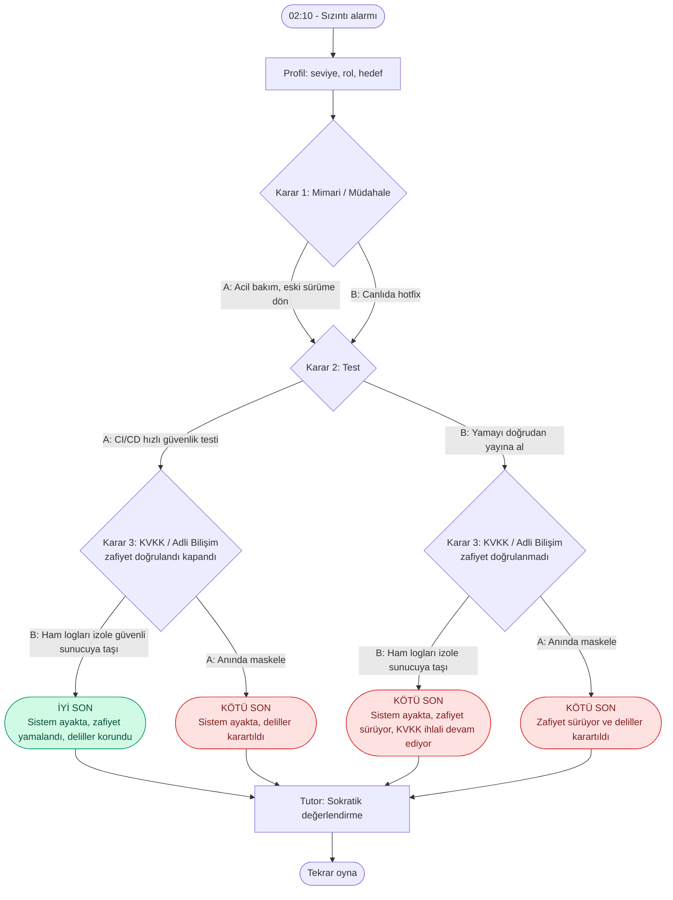

# SE Primer — Spesifikasyon (spec.md)

## 1. Problem Tanımı

Yazılım mühendisliği öğrencileri, canlıdaki bir sistemde yaşanan **kriz anında** teknik karar (mimari, test) ile hukuki/adli karar (KVKK, delil bütünlüğü) arasındaki gerilimi derslerde nadiren birlikte deneyimler. Kriz yönetimi genellikle "doğru cevabı ezberlemek" olarak öğretilir; oysa gerçek hayatta her karar zaman baskısı altında verilir ve bir sonraki kararı etkiler.

**SE Primer**, canlıya alınmış kurgusal bir mobil uygulamada (ör. "YolArkadaşı") tespit edilen kritik bir **veri sızıntısını** (KVKK ihlali + siber tehdit) konu alan, mobil-öncelikli, metin tabanlı bir karar oyunudur. Oyuncu 3 ardışık karar verir; Sokratik bir AI Tutor doğru cevabı vermez, oyuncuya sorular sorarak kendi gerekçesini kurdurur. Oyun, kararların birleşik sonucuna göre **İyi Son** veya **Kötü Son** ile biter.

**Öğrenme çıktıları:**
- Acil müdahale (rollback vs hotfix) takaslarını gerekçelendirebilmek
- Yayın öncesi hızlı güvenlik testinin değerini açıklayabilmek
- Kişisel veri maskeleme ile adli delil koruma arasındaki sırayı ve riski yönetebilmek

## 2. Kapsam Dışı (Bilinçli Olarak Yapılmayanlar)

- Kullanıcı hesabı / giriş / kayıt (oturum kalıcılığı yok)
- Gerçek tehdit verisi veya gerçek kullanıcı verisi (tüm log ve kişi verileri sentetiktir)
- Native mobil build (iOS/Android); yalnızca mobil görünümlü web uygulaması
- Gerçek CI/CD, gerçek sunucu veya gerçek adli bilişim aracı entegrasyonu (hepsi simüle edilir)
- Çok oyunculu mod, skor tablosu, backend veritabanı
- Gerçek saldırı/exploit adımlarının anlatılması
- Çoklu dil (yalnızca Türkçe)

## 3. Kabul Kriterleri

| # | Kriter | Doğrulama |
|---|--------|-----------|
| AC-1 | Oyun, oyuncudan **seviye, rol ve hedef** bilgisi alınmadan başlamaz; üçü dolmadan "Başla" butonu pasiftir ve hikâye bu profile göre uyarlanır. | Cypress: `baslat-btn` disabled → enabled |
| AC-2 | Oyun tam olarak **3 ardışık karar** sunar; her kararda 2 seçenek vardır, seçim **onay** gerektirir ve onaylandıktan sonra geri alınamaz. | Cypress: `karar-a-btn`/`karar-b-btn` → `karar-onayla-btn` |
| AC-3 | Sonuç **deterministik kuralla** belirlenir (AI'dan bağımsız): **Karar 2 = A (hızlı güvenlik testi) VE Karar 3 = B (ham logları izole sunucuya taşı)** ise İyi Son, aksi hâlde Kötü Son. Kötü Son ekranı nedeni (zafiyet sürüyor / deliller karartıldı) listeler. Karar 1 sonucu belirlemez, yalnızca süreyi ve hikâyeyi etkiler. | Cypress: 4 yol (1 iyi + 3 kötü) |
| AC-4 | AI Tutor **hiçbir zaman doğrudan cevap vermez**; her yanıt en az bir Sokratik soru içerir ve **son satırda** `[DURUM: aşama=…; saat=…]` etiketi bulunur. Arayüz bu etiketi ayrıştırıp gösterir. | Cypress: `durum-etiketi` içeriği; prompt incelemesi |
| AC-5 | E2E testleri, `generateContent` çağrıları `cy.intercept` ile sabitlenmiş hâlde, gerçek ağ/API anahtarı olmadan, mobil viewport'ta (390×844) hem İyi Son hem Kötü Son yollarını geçer. | `npx cypress run` |

## 4. Karar Tablosu ve Oyun Saati

Başlangıç saati **02:10** (alarm). Her seçim saate dakika ekler; saat `[DURUM]` etiketinde ve arayüzde görünür.

| Karar | Seçenek A | Seçenek B |
|-------|-----------|-----------|
| **K1 Mimari/Müdahale** | Uygulamayı acil bakıma al, eski sürüme dön (+25 dk) | Canlıda hotfix (yama) çıkar (+45 dk) |
| **K2 Test** | CI/CD'de hızlı güvenlik testi koş (+15 dk) | Acil yamayı doğrudan yayına al (+5 dk) |
| **K3 KVKK/Adli Bilişim** | Sızan loglardaki kullanıcı verisini anında maskele (+10 dk) | Logları ham hâliyle izole güvenli sunucuya taşı (+20 dk) |

## 5. Akış Şeması



## 6. Sonuç Kuralı (Sözde Kod)

```
if K2 == "A" and K3 == "B":
    sonuc = "IYI"
else:
    sonuc = "KOTU"
    nedenler = []
    if K2 == "B": nedenler.append("zafiyet_suruyor")      # KVKK ihlali devam ediyor
    if K3 == "A": nedenler.append("deliller_karartildi")
```

## 7. Notlar

- Sonuç mantığı istemcide deterministiktir; AI yalnızca anlatım ve Sokratik soru üretir (test edilebilirlik ve tutarlılık için).
- Senaryodaki KVKK bildirim süreleri (ör. Kurul'a 72 saat içinde bildirim) ders materyalinizle teyit edilip hikâye metnine eklenmelidir.

## v2.0 Makine Öğrenmesi (ML) Gereksinimi
* **Gereksinim:** Sistem, oyuncunun karar süreleri ve önceki hatalarını değerlendirerek statik kural setine ek olarak ML destekli ipucu olasılığını hesaplayacaktır.
* **Eval Metriği ve Kabul Eşiği:** Doğruluk (Accuracy) ≥ %70. (Eşik, eğitimden önce `train.py` içine sabitlenmiştir).
* **Kabul Örnekleri (Altın Standart):**
  1. Deneyimsiz (seviye=2) bir oyuncu 45 saniye boyunca seçim yapamaz ve daha önce 1 kez yanlış yapmışsa sistem ipucu üretebilmelidir.
  2. Deneyimli (seviye=0) bir oyuncu 8 saniye içinde hızlıca tıklıyorsa sistem ipucu üretmemelidir.
  3. Deneyimli (seviye=0) bir oyuncu arka arkaya 2 kez yanlış yola sapmışsa, hızından bağımsız olarak sistem müdahale edebilmelidir.